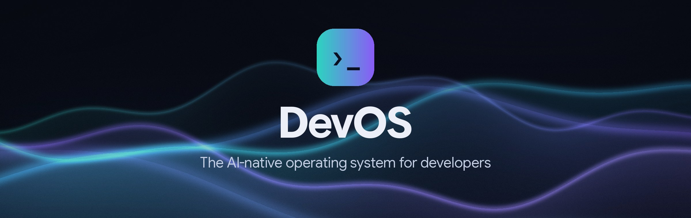
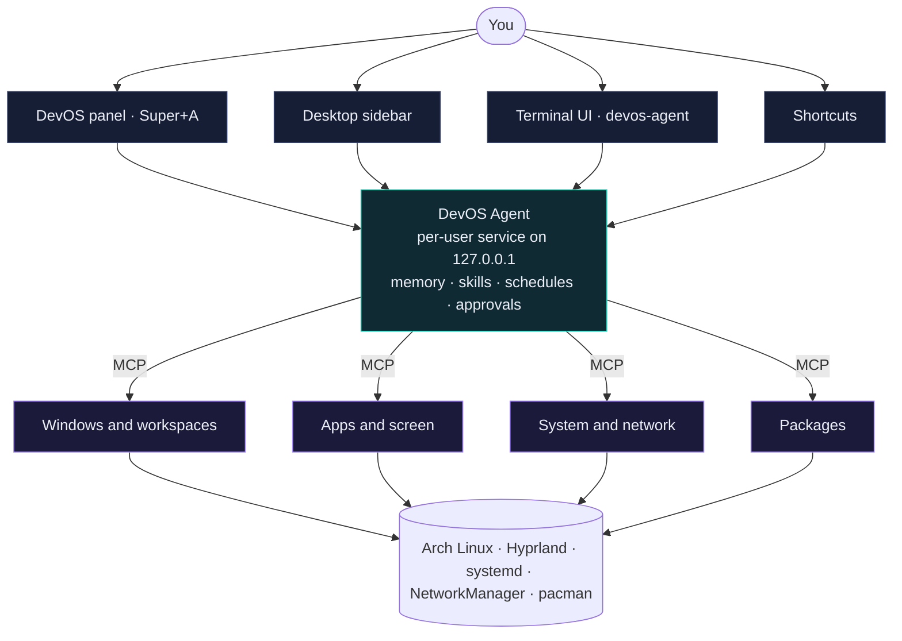
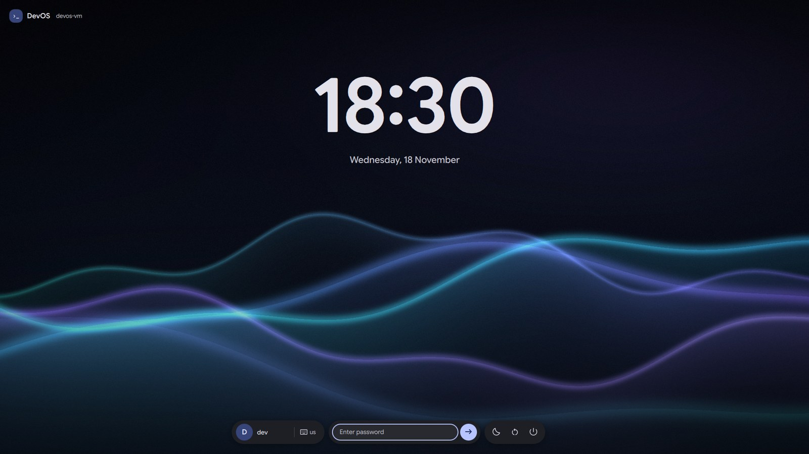
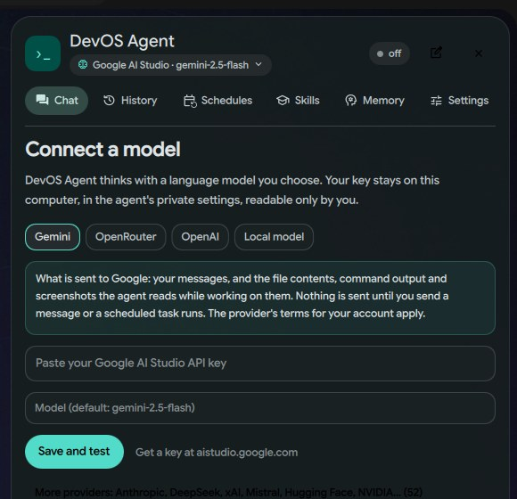
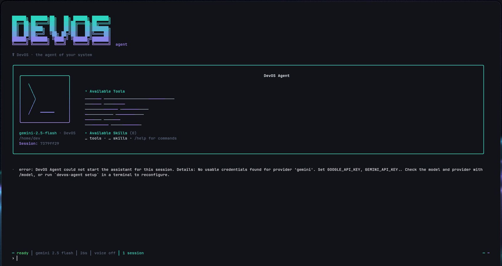
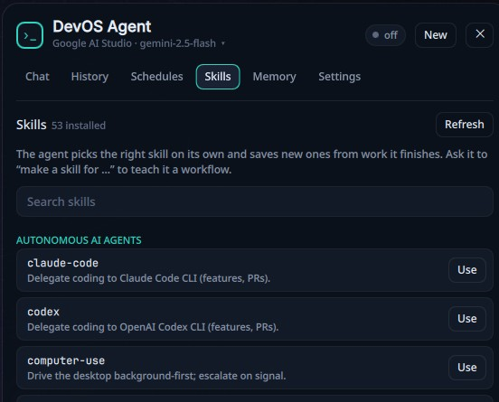
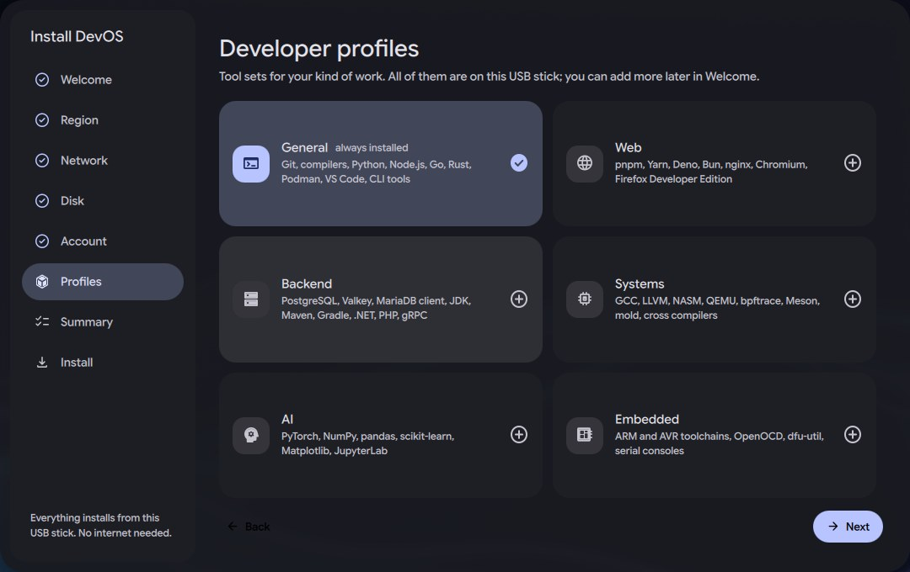
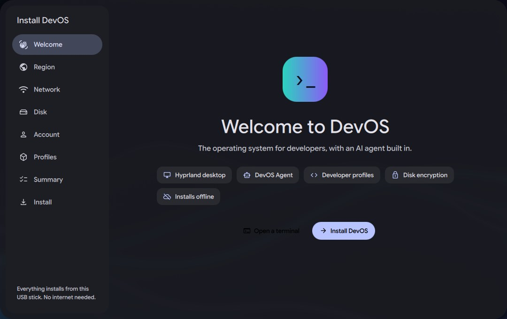
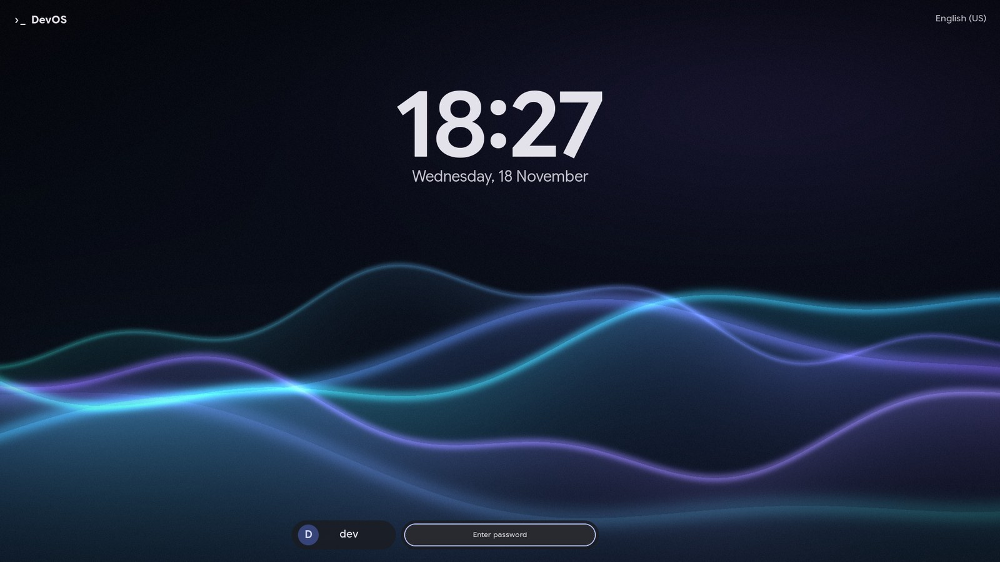

<div align="center">



<br>

**A developer-focused Linux distribution where an AI agent lives at the core of the operating system.**<br>
It sees the system, acts through controlled tools, and automates work on its own schedule.

<br>

[](https://archlinux.org/)
[](https://hyprland.org/)
[](https://m3.material.io/)
[](#-the-agent)
[](ROADMAP.md)
[](LICENSE)
[](https://github.com/DevOS-Ai/DevOS/actions/workflows/ci.yml)

[**Overview**](#-overview) · [**The Agent**](#-the-agent) · [**Screenshots**](#-screenshots) · [**Install**](#-install) · [**Build**](#-build-from-source) · [**Roadmap**](#-roadmap) · [**Docs**](#-documentation)

</div>

<br>

<table align="center">
<tr>
<td align="center" width="140">

</td>
<td>

**Supported by the Faculty of Artificial Intelligence,<br>Islamic Azad University, Tabriz Branch**

The university sponsors DevOS and hosts its official package mirror.

</td>
</tr>
</table>

<br>

## ◆ Overview

Today, AI assistants live *beside* the operating system: in a browser tab or a separate app. They can't see your windows, packages or network, and they can't act on them. So developers end up copying commands between a chat window and a terminal. Every conversation starts from zero, and nothing runs on its own.

**DevOS turns the agent into a layer of the operating system.** DevOS Agent starts when you log in and runs as a per-user system service. It reaches the system through a set of typed, permission-checked tools, and you can call it from anywhere: the desktop, a keyboard shortcut or the terminal.

> **AI operates the system *through* DevOS, never around it.** The agent proposes; DevOS decides what is allowed; the user approves anything that changes the system.

<br>

<table>
<tr>
<td width="33%" valign="top">

### 🧠 Agent at the core
DevOS Agent runs from login as a per-user service on `127.0.0.1`, with its own key, memory, skills and scheduler.

</td>
<td width="33%" valign="top">

### 🛠️ Real system tools
**17 MCP tools** for windows, workspaces, apps, screenshots, network, audio, brightness and packages. Every change needs your approval.

</td>
<td width="33%" valign="top">

### ⏱️ Automation
Recurring jobs in plain language, **50+ skills** the agent picks on its own (and learns new ones), and memory that carries across conversations.

</td>
</tr>
<tr>
<td valign="top">

### 🖥️ Everywhere you work
A Material You panel on the desktop (<kbd>Super</kbd> <kbd>A</kbd>), the end-4 sidebar, and a full terminal UI with `devos-agent`, over SSH too.

</td>
<td valign="top">

### 🔐 You stay in control
Local-only API, approval for every change, package changes through the polkit prompt (never sudo), an audit log, and telemetry **off** by default.

</td>
<td valign="top">

### 💿 Graphical, offline install
A live Hyprland installer with disk encryption (LUKS2) and six developer profiles. **Every package is on the USB stick**, so you need no internet.

</td>
</tr>
</table>

<br>

## ◆ The agent



### System tools

| Area | Tools | What the agent can do |
| :-- | :-- | :-- |
| **Desktop** | `desktop_state` `focus_window` `switch_workspace` `move_window` `window_action` | Read monitors, workspaces and windows; arrange and manage them |
| **Apps & screen** | `list_apps` `launch_app` `screenshot` `notify` | Find and start applications, look at the screen, send notifications |
| **System & network** | `system_status` `set_volume` `set_brightness` `wifi_networks` `wifi_connect` | Report system health, adjust audio and brightness, join Wi-Fi |
| **Packages** | `packages_search` `packages_installed` `packages_change` | Search, list, install and remove software with the administrator's password |

Read-only tools run freely. **Any tool that changes the desktop or the system asks you first**, and every call is written to the DevOS audit log.

### Models

You choose the model: **52 providers**, from Gemini, OpenAI and Anthropic to OpenRouter, DeepSeek and a **local model** on your own machine. Keys are stored only in the user's private agent settings (`0600`) and never leave the machine except to the provider you chose.

<br>

## ◆ Screenshots

<table>
<tr>
<td colspan="2"><p align="center"><sub><b>Login</b>: the end-4 lock design on Hyprland, colors from the wallpaper</sub></p></td>
</tr>
<tr>
<td width="38%"><p align="center"><sub><b>DevOS Agent panel</b>: chat, history, schedules, skills, memory, settings</sub></p></td>
<td width="62%"><p align="center"><sub><b>Terminal UI</b>: <code>devos-agent</code>, the same agent in any terminal</sub></p></td>
</tr>
<tr>
<td><p align="center"><sub><b>Skills</b>: picked automatically, learned from finished work</sub></p></td>
<td><p align="center"><sub><b>Installer</b>: six developer profiles, all available offline</sub></p></td>
</tr>
<tr>
<td><p align="center"><sub><b>Installer</b>: welcome</sub></p></td>
<td><p align="center"><sub><b>Lock screen</b>: hyprlock in the same design</sub></p></td>
</tr>
</table>

<br>

## ◆ Developer profiles

The installer sets up **General** on every system; the others are one click away, during installation or later from Welcome.

| Profile | Highlights |
| :-- | :-- |
| **General** | Git, GitHub CLI, Clang/LLVM, CMake, Ninja, GDB, Python, uv, Node.js, TypeScript, Go, Rust, Podman, VS Code, Neovim, ripgrep, fzf, tmux |
| **Web** | pnpm, Yarn, Deno, Bun, nginx, Chromium, Firefox Developer Edition |
| **Backend** | PostgreSQL, Valkey, MariaDB client, OpenJDK, Maven, Gradle, .NET SDK, PHP, Composer, gRPC |
| **Systems** | GCC, LLVM, NASM, QEMU, OVMF, bpftrace, Meson, ccache, mold, AArch64 cross compiler |
| **AI** | PyTorch, NumPy, pandas, scikit-learn, Matplotlib, JupyterLab |
| **Embedded** | ARM and AVR toolchains, OpenOCD, dfu-util, avrdude, picocom, minicom |

<br>

## ◆ Install

> [!NOTE]
> DevOS is in **preview** (0.1.0). Try it in a virtual machine or on a spare disk.

**Requirements:** a 64-bit PC with **UEFI** firmware (BIOS boot is not supported), **8 GB RAM** and a **32 GB** disk recommended, and a **16 GB** USB stick.

1. Write the ISO to a USB stick (for example with `dd`, Ventoy or Fedora Media Writer).
2. Boot it. The live system opens the **DevOS Installer** straight away.
3. Choose region, disk (optionally encrypted), account and profiles. **No network connection is needed.**
4. Restart into DevOS, open the panel with <kbd>Super</kbd> <kbd>A</kbd>, connect a model, and start working.

<details>
<summary><b>Unattended and text-mode installs</b></summary>

<br>

From the live system's terminal:

```bash
sudo devos-install                       # text installer
sudo devos-install --config install.conf # unattended, see installer/example.conf
```

</details>

<br>

## ◆ Build from source

On an Arch Linux host:

```bash
sudo pacman -S --needed archiso grub mtools base-devel git
scripts/build-repo.sh          # build the DevOS packages into repo/x86_64
sudo scripts/build-iso.sh      # build dist/devos-<version>-x86_64.iso
```

The ISO carries every package an install can need. To keep the package cache and staging on a larger disk:

```bash
sudo DEVOS_PKG_CACHE=/data/devos/pkgcache DEVOS_MEDIUM_DIR=/data/devos/medium \
     scripts/build-iso.sh -o /data/devos/dist
```

See **[docs/building.md](docs/building.md)** for checks and VM testing.

<br>

## ◆ Repository

```text
agent/        DevOS Agent: launcher, defaults, terminal skin, engine branding
ai/           DevOS system tools (MCP server), policy and helpers
desktop/      DevOS shell (panel, Welcome), login and lock, end-4 integration, wallpapers
installer/    devos-install, the graphical installer (Quickshell) and live session
iso/          archiso profile of the live system
packaging/    PKGBUILDs of the [devos] repository
developer/    developer profiles, runtimes and tools
boot/         GRUB theme and Plymouth splash
scripts/      build, check and render scripts
docs/         documentation
```

<br>

## ◆ Roadmap

| Phase | Status |
| :-- | :-- |
| Foundation: archiso profile, `[devos]` repository, reproducible ISO | ✅ Done |
| Desktop: Hyprland, end-4, Material You design system, login, lock, splash | ✅ Done |
| Developer environment: six profiles | ✅ Done |
| Installer: graphical, offline, LUKS2 | ✅ Done |
| DevOS Agent: system tools, approvals, schedules, skills, memory, terminal UI | ✅ Done |
| Hardware testing and performance measurements | 🔜 Next |
| Package signing and security review | 🔜 Next |
| Documentation and the **DevOS 0.1.0** release | 🔜 Next |

Details in **[ROADMAP.md](ROADMAP.md)**; requirements in the **[SRS](SRS.md)**.

<br>

## ◆ Documentation

| | |
| :-- | :-- |
| **[Software Requirements Specification](SRS.md)** | Architecture, decisions and requirements |
| **[Building](docs/building.md)** | Packages, ISO, checks, VM testing |
| **[Keybindings](docs/keybindings.md)** | Desktop and agent shortcuts |
| **[Security](docs/security.md)** | Security controls and known gaps |
| **[Contributing](CONTRIBUTING.md)** | How to propose and submit changes |

<br>

## ◆ Founder

<table>
<tr>
<td>

### Ehsan Fazli
**Founder and lead developer of DevOS**

Ehsan designed DevOS and builds it: the distribution, the desktop, the installer and the system agent at its core.

</td>
</tr>
</table>

<br>

## ◆ Acknowledgements

DevOS stands on the shoulders of open source:
[Arch Linux](https://archlinux.org/) ·
[Hyprland](https://hyprland.org/) ·
[end-4 dots-hyprland](https://github.com/end-4/dots-hyprland) ·
[Quickshell](https://quickshell.org/) ·
[Model Context Protocol](https://modelcontextprotocol.io/) ·
[Material Symbols and Google Fonts](https://fonts.google.com/).
DevOS Agent is built on an MIT-licensed open-source agent engine; its license ships with the package.

## ◆ License

DevOS is free software, licensed under the **[GNU General Public License v3.0 or later](LICENSE)**. Bundled third-party components keep their own licenses.

<br>

<div align="center">


<sub>Supported by the Faculty of Artificial Intelligence · Islamic Azad University, Tabriz Branch</sub>

<br><br>

**DevOS** · Build. Think. Automate.

</div>
